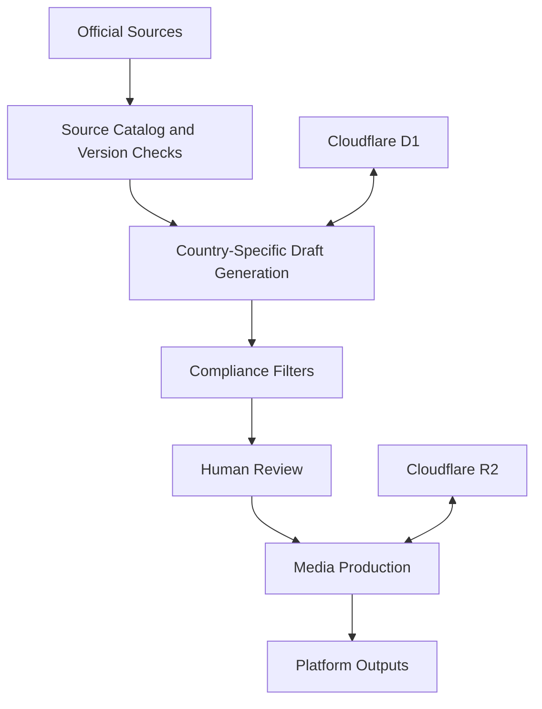

# Novarive Wellness Content Automation Platform

A multi-country content operations platform for preparing, reviewing, and managing localized wellness content across social media channels while preserving source traceability and human approval.

> This is a public portfolio showcase. Business data, credentials, downloaded source documents, and the complete production source code remain private.

## Highlights

- Supports localized workflows for the United States, United Kingdom, and Canada
- Manages content for Instagram, TikTok, Facebook, and YouTube
- Tracks 14 official source records and their validity periods
- Organizes 11 core content concepts and 44 platform-specific drafts
- Manages seven approved media projects and 28 platform outputs
- Requires human review before content can move toward publication
- Prevents duplicate YouTube uploads
- Applies country-specific compliance filters to health, weight-loss, guarantee, and earnings claims
- Encrypts Meta OAuth tokens at rest and never exposes them to the client

## Architecture

## Security and Compliance

- Server-side authorization protects all application routes
- State-changing requests require same-origin validation
- OAuth tokens are encrypted with AES-GCM before storage
- Local sessions, credentials, databases, and temporary files are excluded from version control
- Source version and usage-right checks prevent unapproved media from reaching publication

## Technology Stack

- TypeScript
- React and Next.js
- Cloudflare Workers
- Cloudflare D1 and R2
- Drizzle ORM and SQLite
- Tailwind CSS
- Meta Graph API
- YouTube Data API

## Repository Status

The production implementation remains private because it contains proprietary workflows, operational data, and integration configuration. A technical walkthrough or demonstration can be provided on request.

## Author

Developed by Nurullah Şahin.
